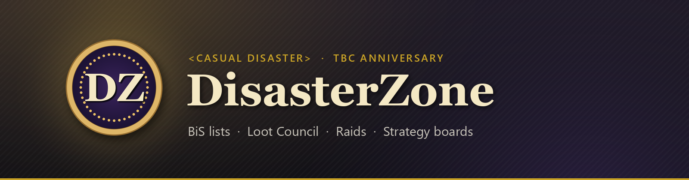

  

  <b>The guild addon of &lt;Casual Disaster&gt;</b> for the World of Warcraft TBC Anniversary realms. 
  Best-in-slot lists · a Loot Council that sees them · raid sign-ups and teams · strategy boards · and a few games on the side

<h2 align="center">Get the launcher</h2>

  One click installs DisasterZone, keeps it up to date, and keeps backups you can go back to.

  &nbsp;
  &nbsp;
  

  <b>Windows</b> may say <i>Windows protected your PC</i>: click <i>More info</i>, then <i>Run anyway</i>.
  &nbsp;·&nbsp; <b>macOS</b>: the first time, right-click the app and choose <i>Open</i>.
  &nbsp;·&nbsp; <b>Linux</b>: make the <code>.AppImage</code> executable, then run it.

<table align="center">
  <tr>
    <td align="center" width="25%"><b>Finds the game</b> Windows, macOS, and Linux under Wine, Lutris, Bottles or Steam</td>
    <td align="center" width="25%"><b>Small updates</b> Downloads only the files that changed, and checks every one</td>
    <td align="center" width="25%"><b>Safe to undo</b> Backs up the addon and your saved variables before each update</td>
    <td align="center" width="25%"><b>Signed</b> Only installs releases signed by the DisasterZone key</td>
  </tr>
</table>

<h2 align="center">Install by hand</h2>

  

  Take <code>DisasterZone-&lt;version&gt;.zip</code> from the newest <b>DisasterZone</b> release and unzip it into 
  <code>World of Warcraft\_anniversary_\Interface\AddOns</code>. It holds two folders, <code>DisasterZone</code> and <code>DisasterZone_Rooms</code>. 
  Small fixes also arrive in game, from guildmates who already have them, no download needed.

  
<b>What is in this repository</b>

   

  - `channels/` — the signed release lists the launcher reads (`stable`, `beta`).
  - `objects/` — the addon's files, one per version of each file, named by their SHA-256.
  - `launcher/` — the launcher's source (Tauri: Rust + HTML); `.github/workflows/launcher.yml` builds it for every platform.
  - Releases — each addon version as a zip, and each launcher version with its installers.

   
   
  Made for &lt;Casual Disaster&gt;

